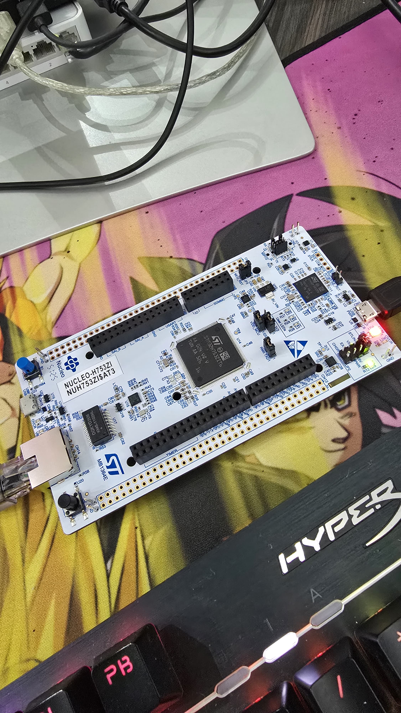
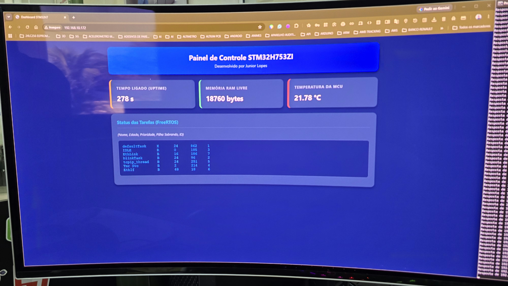

# Servidor Web Embarcado com lwIP, FreeRTOS e Gerador de Pulsos (STM32H753)

Firmware avançado desenvolvido para a família de microcontroladores **STM32H7** utilizando **FreeRTOS**, a pilha TCP/IP **lwIP** (Netconn API) e o ecossistema STM32Cube. O sistema implementa um **Web Dashboard responsivo** integrado diretamente na MCU para monitoramento de telemetria em tempo real e controle de hardware por hardware (geração de pulsos via Timer).




---

## 📋 Funcionalidades Principais

- **Servidor Web HTTP Embutido (`lwIP` / Netconn API):** Executa uma página HTML responsiva hospedada diretamente na memória flash/RAM do microcontrolador na porta 80.
- **Dashboard Web Dinâmico (AJAX / Fetch API):** 
  - Atualização automática de métricas a cada 2 segundos sem recarregar a página.
  - Indicadores visuais de **Uptime**, **Memória RAM Livre (Heap)** e **Temperatura interna da MCU**.
  - Monitoramento em tempo real do status das tarefas do **FreeRTOS** (`vTaskList`).
- **Gerador de Pulso Digital Controlado por Web:**
  - Interface interativa para ajuste dinâmico do tempo de pulso (de 0 a 5000 ms).
  - Acionamento simultâneo do LED Vermelho físico e do pino **PB1** (para medição em osciloscópio).
- **Controle por Hardware (TIM2 em Modo de Pulso Único):** O temporizador TIM2 opera de forma totalmente autônoma em hardware baseado no clock real de 200 MHz do H7 para garantir precisão milimétrica no disparo do sinal.

---

## 🌐 Endpoints da API Web (HTTP)

| Rota / Endpoint | Método | Descrição |
| :--- | :---: | :--- |
| **`/`** | `GET` | Retorna o painel de controle principal (Dashboard HTML5/CSS/JS responsivo). |
| **`/metrics`** | `GET` | Retorna os cards atualizados de Uptime, Heap livre e Temperatura da MCU. |
| **`/tasks`** | `GET` | Retorna a tabela formatada com o estado, prioridade e uso de pilha das tarefas do FreeRTOS. |
| **`/disparo?tempo=X`** | `GET` | Aciona um pulso digital de `X` milissegundos no pino **PB1** e LED Vermelho. |

---

## 🛠️ Especificações Técnicas e Periféricos

- **Microcontrolador:** STM32H753ZI (ARM Cortex-M7 a 400 MHz).
- **Sistema Operacional:** FreeRTOS (com suporte a threads, filas e gerenciamento dinâmico de Heap).
- **Pilha de Rede:** lwIP (Lightweight IP) utilizando a API Netconn baseada em sockets/conexões.
- **Sensor de Temperatura Interno:** Lido através do **ADC3** configurado em resolução de 16 bits.
- **Temporização e Pulsos:** 
  - **TIM2:** Configurado no modo de pulso único (*One-Pulse Mode*) com prescaler voltado para contagem exata em milissegundos.
  - **DWT:** Disponibilizado para funções de delay de alta precisão baseadas no contador de ciclos da CPU.

---

## 📊 Arquitetura de Tarefas (FreeRTOS)

1. **`defaultTask` (Rede / Servidor Web):**
   - Aguarda a estabilização da rede e inicializa a pilha lwIP.
   - Abre e gerencia o socket TCP na porta 80, aceitando conexões de clientes e repassando requisições para a função `http_server_serve()`.
2. **`blinkTask` (Indicador de Vida / Heartbeat):**
   - Alterna o estado do LED Amarelo a cada 500 ms para indicar que o núcleo do sistema operacional está ativo e saudável.

---

## 📁 Estrutura do Projeto

```text
├── Core/
│   ├── Inc/                # Arquivos de cabeçalho (main.h, lwip.h, FreeRTOSConfig.h)
│   └── Src/
│       ├── main.c          # Inicialização do sistema, configuração de clocks, MPU, tarefas e servidor HTTP
│       └── ...             # Arquivos gerados pelo CubeMX (gpio.c, adc.c, etc.)
├── LWIP/                   # Configurações e adaptações da pilha TCP/IP lwIP
├── FreeRTOS/               # Código-fonte e portabilidade do kernel FreeRTOS
└── README.md               # Documentação do projeto


\## 🚀 Como clonar e compilar

1\. Clone o repositório em sua pasta de projetos:

&#x20;  ```bash

&#x20;  git clone https://github.com

&#x20;  ```

2\. Abra o MPLAB X IDE.

3\. Vá em \*\*File > Open Project\*\* e selecione a pasta `GoHobby\_Servo.X`.

4\. Certifique-se de ter o compilador XC8 instalado e configurado nas propriedades do projeto.

5\. Clique em \*\*Clean and Build\*\*.


